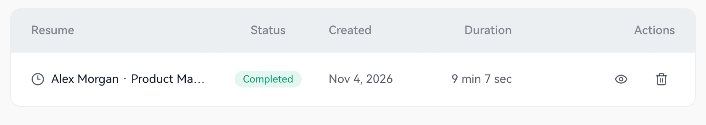

Open **Interview Records** in the sidebar to see status, creation time, duration, and available actions. Recent records on Home provide another entry point.

## Open a record

1. Find the session by resume, company, time, and status.
2. Select **View Report** for a completed session.
3. Switch between **Interview summary**, **Q&A**, and **Transcript**.
4. Use **Back to interview records** to view another session.

<Frame caption="Open the report from a completed interview record.">
  
</Frame>

| Tab | Purpose |
|---|---|
| Interview summary | Overview and improvement priorities |
| Q&A | Questions and AI suggestions |
| Transcript | Actual conversation and context |

Reports reflect the content produced during that session. Answer fully aloud during practice and check microphone settings for a useful review.

## Ongoing and unwanted records

Use the available rejoin action for an ongoing session. Finish with **End Interview** in the assistant, then return to records. To delete a record, check the session and date, then read the confirmation prompt.

Next: [Summary](/en/review/summary) or [Q&A and transcript](/en/review/qa-and-transcript).
