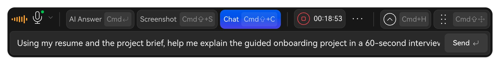

Pulsa **Chat** en la barra para abrir el cuadro de preguntas.

1. Describe la tarea y el resultado deseado.
2. Pulsa **Enviar**.
3. Lee la pregunta y la respuesta; continúa con otra si lo necesitas.

<Frame caption="Utiliza Chat para añadir una pregunta concreta.">
  
</Frame>

Usa las flechas para revisar respuestas. Al finalizar, consulta **Historial de entrevistas → Ver informe → Preguntas y respuestas**.

## Ejemplos

- **Estructura:** «Dame tres puntos para presentar un proyecto de activación de usuarios en una entrevista de product manager».
- **Cálculo:** «Dos grupos de 1.200 personas tienen 372 y 564 activadas. Calcula tasas, mejora absoluta y relativa, y explica la diferencia».
- **Seguimiento:** «Dame tres formas de profundizar en “¿Por qué elegiste esta solución?” y las evidencias necesarias».
- **Documentos:** «Resume objetivos, métricas y aprendizajes del documento seleccionado. Señala lo que no esté especificado».

Verifica los hechos y adapta la respuesta a tu experiencia.

Siguiente: [Práctica](/es/practice/rehearse) o [Revisar preguntas](/es/review/qa-and-transcript).
