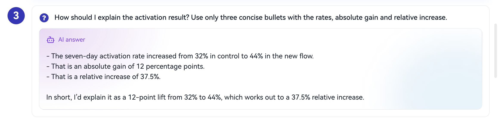

En **Historial de entrevistas → Ver informe**, abre **Preguntas y respuestas** o **Transcripción**.

Las preguntas muestran cada enunciado y respuesta de IA, con navegación para registros largos. Identifica la intención, estructura y evidencias aplicables a tu experiencia, y prepara tu propio esquema.

<Frame caption="Revisa cada pregunta y su respuesta de IA.">
  
</Frame>

La transcripción muestra participantes, tiempos y contexto real. Verifica cifras, términos y nombres con tus documentos. Puedes desplazarte por registros largos y volver arriba.

1. Localiza la pregunta y tu respuesta original.
2. Resume tu conclusión en una frase.
3. Consulta la sugerencia y elige estructura o evidencias útiles.
4. Escribe de tres a cinco puntos y responde de nuevo en voz alta.

Distinguir lo que leíste de lo que dijiste ayuda a orientar el ensayo.

Siguiente: [Próxima práctica](/es/review/improvement).
