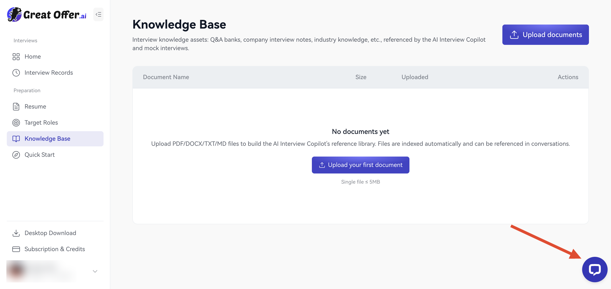
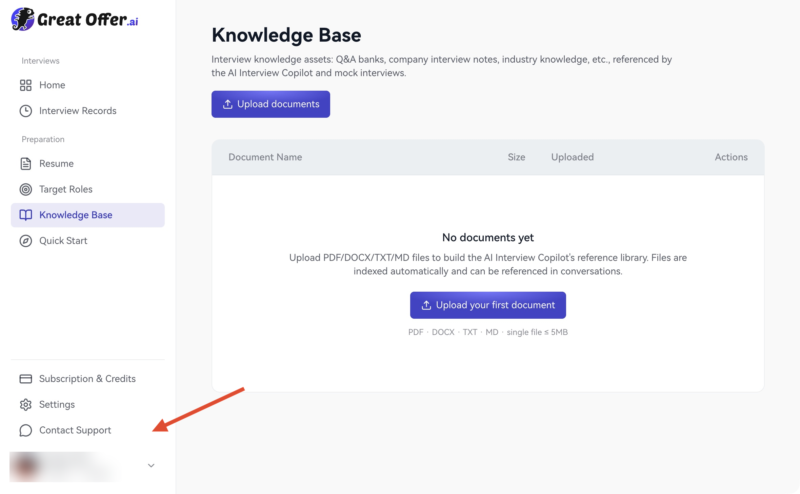

Usa estos canales para ayuda, pedidos o sugerencias.

## Soporte por chat

**Web:** Pulsa el icono de chat de la esquina inferior derecha.

<Frame caption="Web: la flecha señala el icono de soporte en la esquina inferior derecha.">
  
</Frame>

**Escritorio:** Pulsa **Contactar con soporte** en la barra lateral.

<Frame caption="Escritorio: la flecha señala Contactar con soporte en la barra lateral.">
  
</Frame>

Ambas plataformas usan la misma ventana de chat. Describe qué necesitas en el campo de mensaje.

<Frame caption="Ventana de soporte compartida por la web y la aplicación de escritorio.">
  
</Frame>

## Comentarios en la aplicación

<Frame caption="Pulsa 1 Configuración de la aplicación y después 2 Enviar comentarios.">
  
</Frame>

1. Abre **Configuración de la aplicación → Ayuda y comentarios → Enviar comentarios**, o el menú de cuenta.
2. Describe la tarea, pasos y hora.
3. Adjunta hasta seis imágenes JPG, PNG o WebP de hasta 2 MB cada una.
4. Activa registros de diagnóstico solo si lo deseas.
5. Revisa y envía.

<Frame caption="Describe tu sugerencia o problema y añade capturas y registros si los necesitas.">
  
</Frame>

Los registros están desactivados por defecto. Pueden incluir texto de conversaciones junto con información de ejecución, permisos y entorno. Confirma que deseas compartirlo; consulta [Privacidad](/es/privacy/data).

Incluye página, intención, hora, versión, sistema, dispositivos, sesión o pedido y lo que ya has probado. Oculta información privada y no envíes contraseñas, códigos ni números completos de tarjeta.

Soporte y pedidos: [support@greatoffer.ai](mailto:support@greatoffer.ai). Privacidad: [privacy@greatoffer.ai](mailto:privacy@greatoffer.ai).

Consulta también las [preguntas frecuentes](/es/faq).
