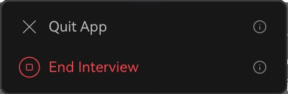

Utilisez **Terminer l’entretien** une fois votre échange fini.

1. Cliquez sur **Durée de l’entretien**.
2. Sélectionnez **Terminer l’entretien** et suivez les indications.
3. Attendez le retour à l’espace de travail.
4. Vérifiez l’état dans les historiques et ouvrez le rapport.

<Frame caption="Sélectionnez End Interview une fois la session terminée.">
  
</Frame>

Une session terminée ne peut être rejointe ; lancez-en une nouvelle.

| Action | Résultat |
|---|---|
| Réduire en widget flottant | Session active ; clic pour restaurer |
| Quitter l’application | Session et consommation de temps continuent |
| Terminer l’entretien | Clôture et consultation dans les historiques |

Si vous avez seulement quitté, rouvrez le client et utilisez l’action de reprise de la session active. Terminez-la ensuite depuis l’assistant. Consultez résumé, questions et transcription ; les crédits consommés sont vérifiables dans **Compte et facturation → Voir l'historique d'utilisation → Utilisation des crédits**.

Suite : [Historiques](/fr/review/records) ou [Utilisation](/fr/account/usage).
