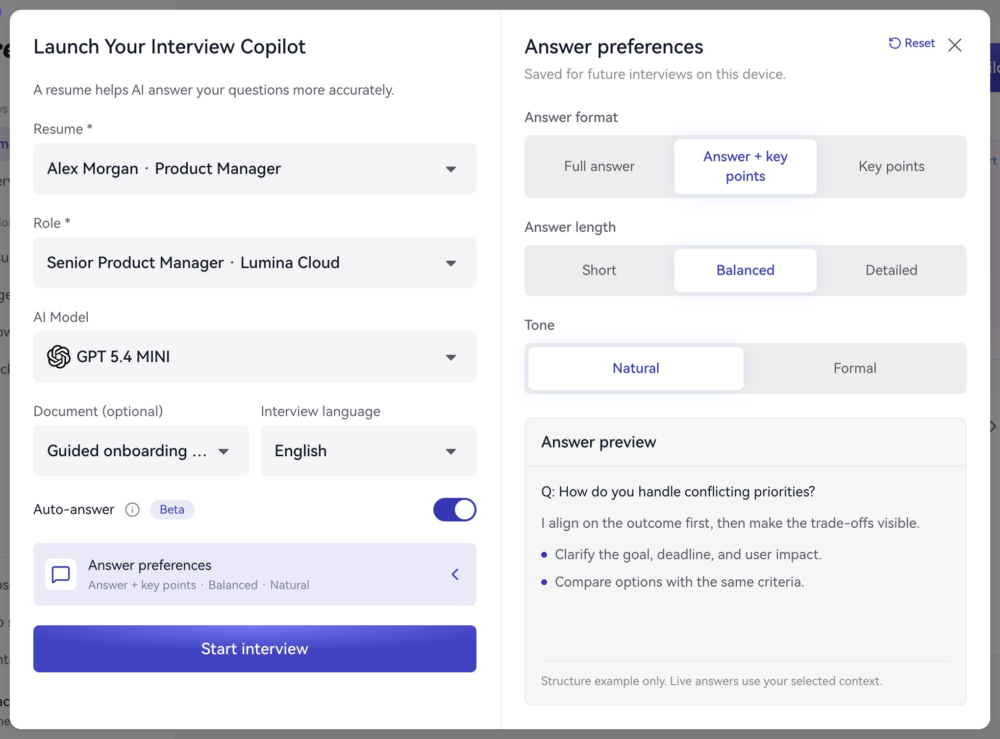

**ホーム → コパイロットを起動 → 回答の設定**を開き、プレビューを確認します。

| 形式 | 用途 |
| --- | --- |
| 完全な回答 | つながった説明を読む |
| 回答 + 要点 | 説明と重要点を確認 |
| 要点のみ | 素早く読み、自分で表現 |

長さは**短め、標準、詳細**、口調は**自然、フォーマル**から選択します。慣れた質問には短め、論理を学ぶときは詳しい回答が向いています。

1. パネルを開きます。
2. 三項目を選択します。
3. プレビューで読みやすさを確認します。
4. 起動前に設定の要約を確認します。

<Frame caption="プレビューを見ながら形式、長さ、口調を調整します。">
  
</Frame>

プレビューは固定の例で、実際の回答は質問と資料に基づきます。初回は**回答 + 要点／標準／自然**を試し、読む速度に合わせて調整してください。要点を自分の言葉で話す練習も有効です。

次へ：[回答方法](/ja/assistant/auto-and-manual)または[練習](/ja/practice/rehearse)。
