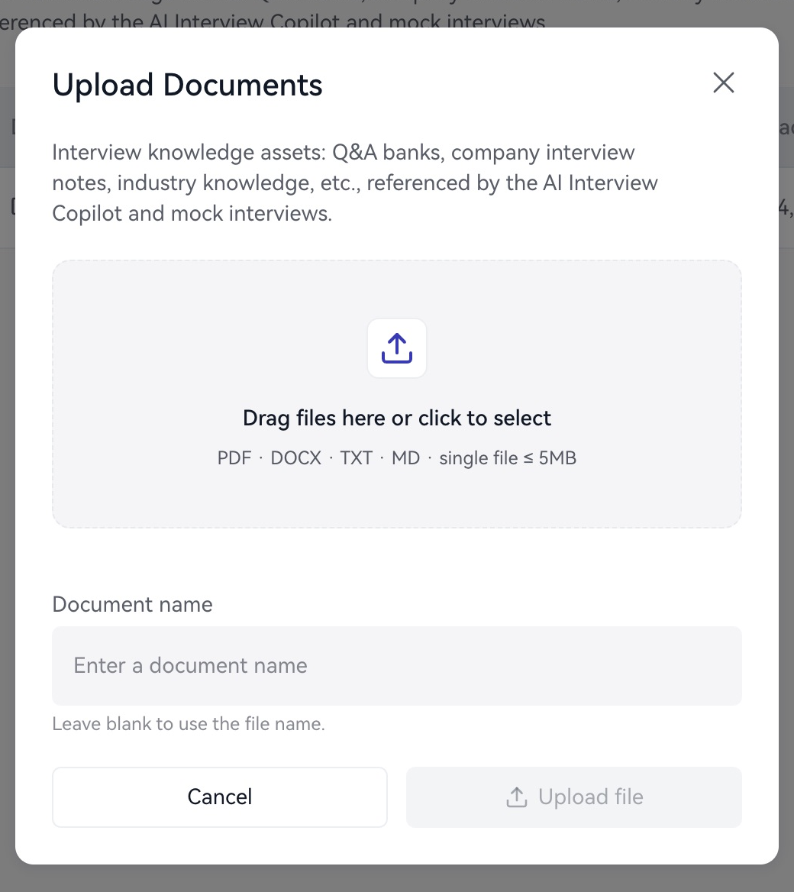

**ナレッジベース**は履歴書以外の背景資料、業界知識、準備した質問などを管理します。

1. **資料をアップロード**を選択します。
2. PDF、DOCX、TXT、MD を選びます。各 5 MB までです。
3. ファイル一覧を確認して送信します。
4. 名前、サイズ、日時を確認します。
5. **編集**で名前と本文を確認・更新します。

<Frame caption="プロジェクト資料をナレッジベースにアップロードします。">
  
</Frame>

## 内容の整理

一つの資料を一つのテーマにまとめ、背景、担当、行動、結果、学びの順に整理します。指標は定義、分母、期間、単位を明記します。

「14 日以内の活性化率、各群 1,200 組織、31% から 47%」なら、「大きく改善」より具体的です。

**ホーム → アシスタントを起動 → 資料（任意）**で選択します。不要なら資料なしを選びます。開始前に職種との関連を確認し、具体的な質問をチャットで試してください。

次へ：[資料の準備](/jp/preparation/materials-guide)または[チャット](/jp/assistant/text-chat)。
