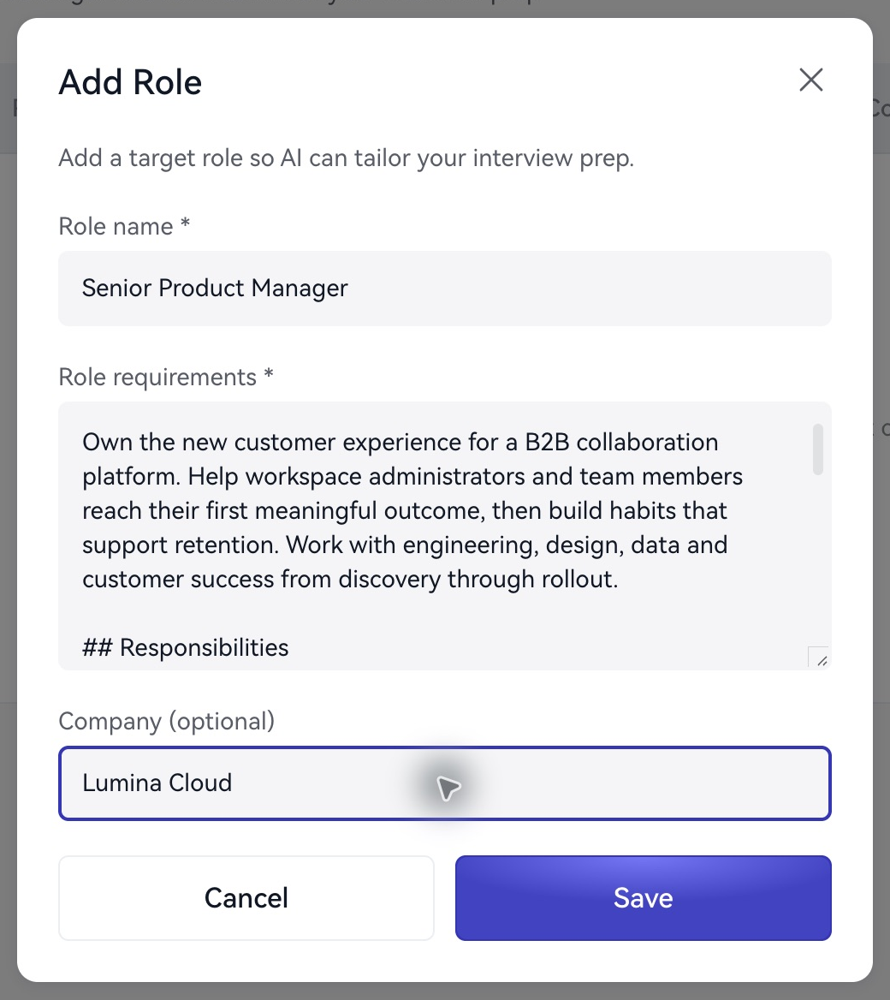

사이드바나 홈에서 **지원 직무**를 엽니다.

1. **직무 추가**를 선택합니다.
2. “시니어 제품 관리자”처럼 이름을 입력합니다.
3. 요구 사항에 업무, 자격, 면접 중점을 붙여 넣습니다.
4. 필요하면 회사를 추가하고 저장합니다.

<Frame caption="지원 직무와 요구 사항을 추가합니다.">
  
</Frame>

사업, 해결할 문제, 기술, 연차, 협업 대상, 직급을 우선하고 불필요한 홍보는 제외합니다.

> 기업 고객 활성화와 유지율을 담당하고 퍼널 지표와 실험을 주도합니다. B2B SaaS 경험이 있으며 개발, 디자인, 영업, 고객 성공과 협업합니다. 중점은 의사결정, 분석, 팀 간 조율입니다.

미리보기와 편집으로 업데이트합니다. 회사나 직급에 따라 요건이 크게 다르면 별도 항목으로 저장하고 시작할 때 선택하세요.

다음: [자료 준비](/ko/preparation/materials-guide) 또는 [설정](/ko/launch/configuration).
