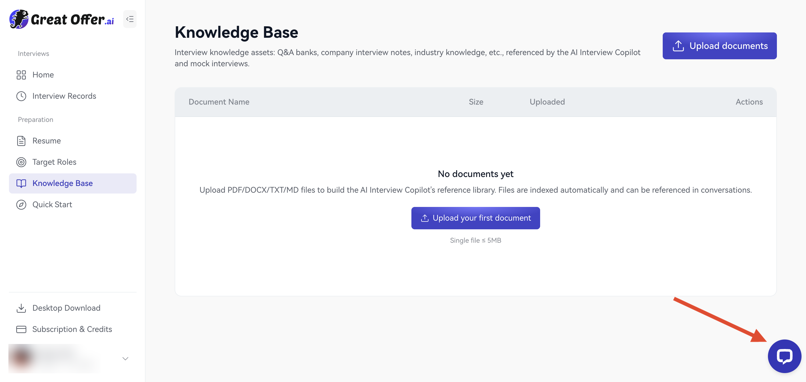
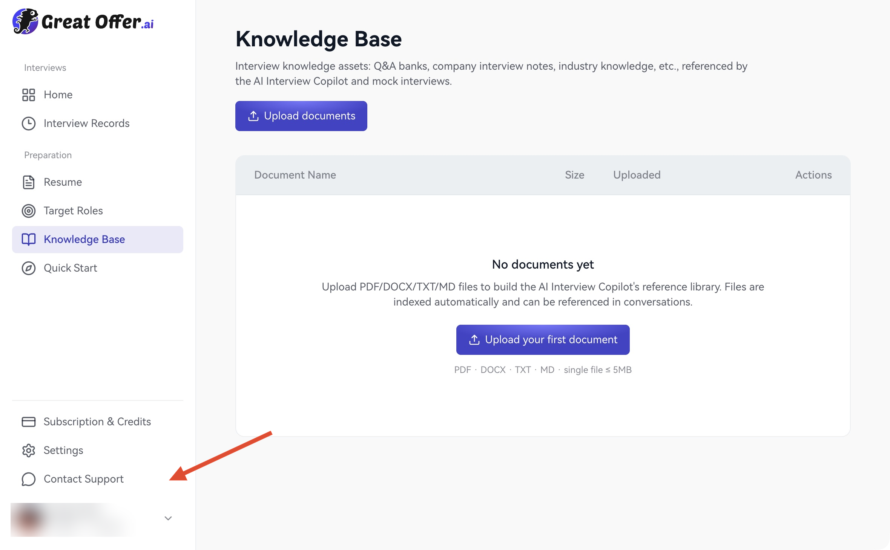

사용 도움, 주문 문의, 제안에 각 채널을 이용하세요.

## 실시간 지원

**웹:** 페이지 오른쪽 아래의 채팅 아이콘을 선택합니다.

<Frame caption="웹: 화살표가 오른쪽 아래 지원 채팅 아이콘을 가리킵니다.">
  
</Frame>

**데스크톱:** 사이드바의 **고객 지원 문의**를 선택합니다.

<Frame caption="데스크톱: 화살표가 사이드바의 고객 지원 문의를 가리킵니다.">
  
</Frame>

두 플랫폼은 같은 지원 채팅 창을 사용합니다. 메시지 입력란에 필요한 도움을 설명하세요.

<Frame caption="웹과 데스크톱 앱에서 공통으로 사용하는 지원 채팅 창.">
  
</Frame>

## 앱 내 피드백

<Frame caption="1 앱 설정, 2 피드백 보내기 순서로 선택합니다.">
  
</Frame>

1. **앱 설정 → 도움말 및 피드백 → 피드백 보내기**를 선택하거나 계정 메뉴의 **의견 보내기**를 엽니다.
2. 목적, 단계, 시각을 적습니다.
3. JPG, PNG, WebP를 최대 6장, 각각 2 MB까지 첨부할 수 있습니다.
4. 필요한 경우 <strong>진단 로그 첨부(선택 사항)</strong>를 선택합니다.
5. 내용을 확인하고 **피드백 제출**을 누릅니다.

<Frame caption="제안이나 문제를 설명하고 필요하면 스크린샷과 로그를 추가하세요.">
  
</Frame>

로그는 기본적으로 꺼져 있습니다. 환경과 권한뿐 아니라 대화 문자가 포함될 수 있습니다. 제공에 동의하는지 확인하세요. [개인정보](/ko/privacy/data)를 참고하세요.

페이지, 목적, 시간, 버전, 장치, 세션·주문, 시도한 작업을 적습니다. 개인정보를 가리고 비밀번호, 인증 코드, 전체 카드 번호는 보내지 마세요.

지원과 주문: [support@greatoffer.ai](mailto:support@greatoffer.ai). 개인정보: [privacy@greatoffer.ai](mailto:privacy@greatoffer.ai).

[자주 묻는 질문](/ko/faq)도 확인하세요.
