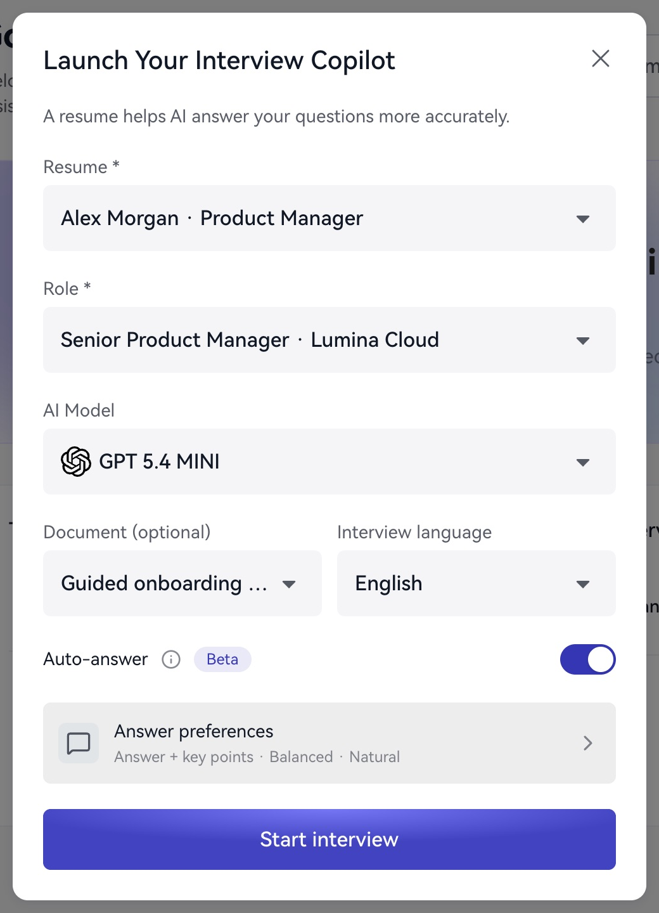
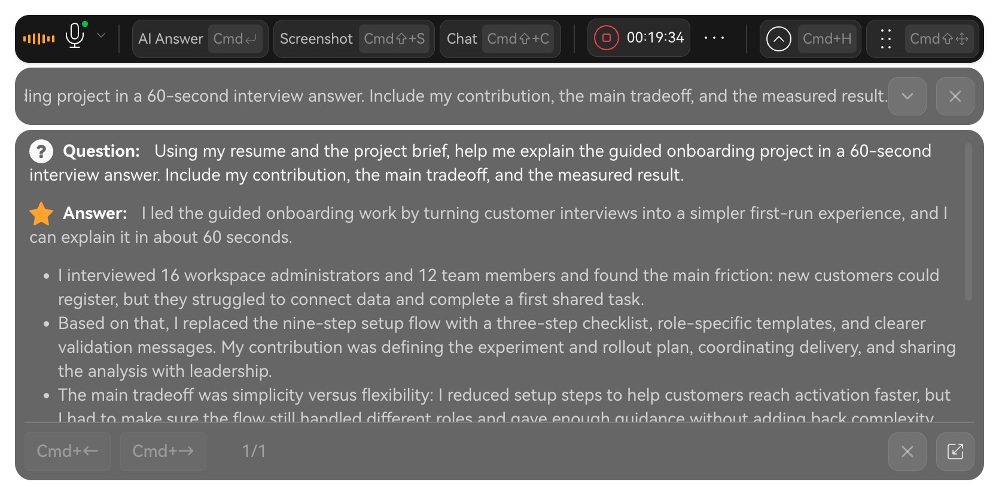

这篇指南带你走完“准备资料—配置助手—进行问答—结束—复盘”。第一次体验可以安排在一次练习通话中。

## 1. 检查设备和账户

进入 **应用设置**，查看麦克风、系统音频和屏幕录制的权限状态，确认面试官音频与麦克风设备。再查看账户卡片或 **订阅与积分**，确认有可用权益。

## 2. 添加一份简历

打开 **简历 → 上传简历**。填写便于辨认的标题，上传 PDF、DOCX、TXT 或 MD 文件，单个文件不超过 5MB。也可以选择 **切换为手动输入**，粘贴简历正文后保存。保存后预览，检查经历、项目、日期与数字。

## 3. 添加一个目标岗位

打开 **目标岗位 → 添加岗位**，填写岗位名称与岗位要求；公司为可选项。建议直接粘贴招聘页面中的职责和要求，然后点击 **保存**。

如果需要补充项目背景或公司研究，可先上传到 **知识库**，启动时再选择使用。

## 4. 配置并启动助手

返回 **首页 → 启动助手**。选择简历、岗位、AI 模型、可选文档和面试语言，确认自动回答与回答偏好，然后点击 **开始面试**。

进入助手后，顶部显示转录区域，中间显示回答区域，工具栏提供 **AI 回答、分析截图、对话、音频设置** 等入口。

<Frame caption="开始前选择资料与回答设置。">
  
</Frame>

## 5. 完成一次问答

最直接的体验方式是点击 **对话**，输入“请用三个要点说明，产品经理如何介绍一次用户激活项目”，再点击 **发送**。问题和 AI 建议会出现在回答区域。

如在练习通话中使用音频，打开 **音频设置**，确认面试官声音来源和自己的麦克风。开启自动回答时，助手会根据识别到的提问生成建议；需要自行控制时机时，可使用 **AI 回答**。

阅读建议后，用自己的表达组织回答。练习时可以口头说出完整答案，为后续复盘留下内容。

<Frame caption="在实时助手中阅读问题与 AI 建议。">
  
</Frame>

## 6. 结束并查看结果

点击工具栏中的 **面试时长**，选择 **结束面试**。等待返回工作台后，打开这场记录，依次查看：

- **面试总结**：面试概览、表现亮点、待提升之处与提升建议。
- **问答**：回看问题和 AI 回答。
- **转录**：查看对话文字、角色和时间位置。

收起助手或退出程序后，会话仍可能继续运行。完成体验后，请使用 **结束面试**。

下一步：[把复盘变成下一次练习](/zh/review/improvement)。
