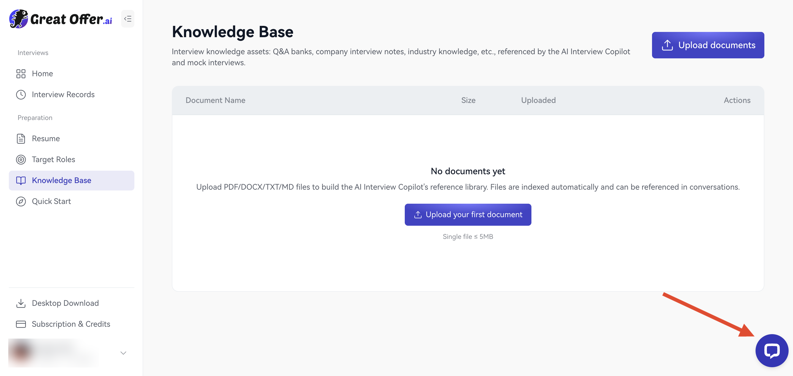
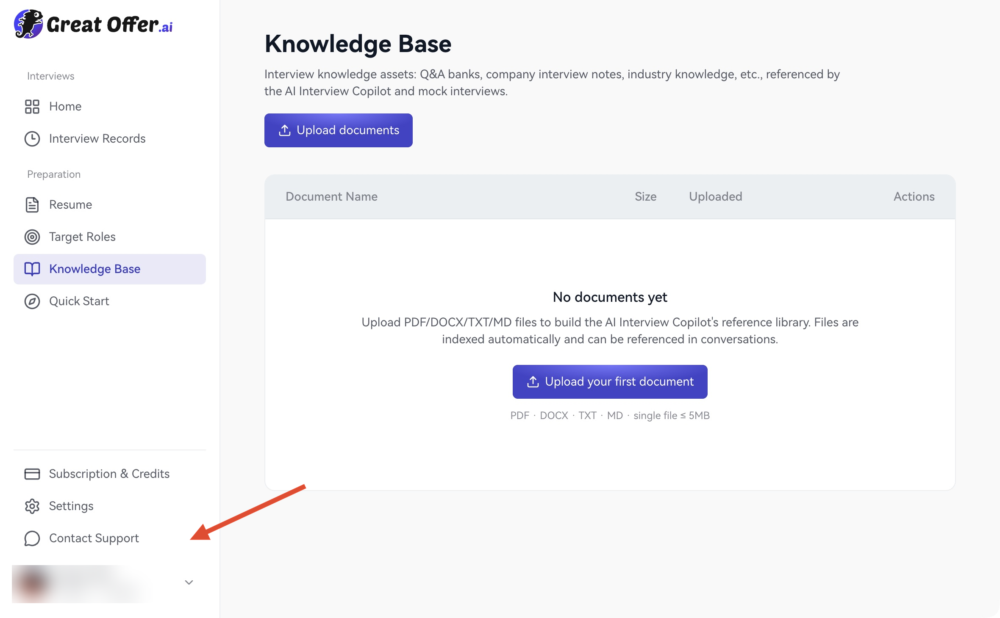
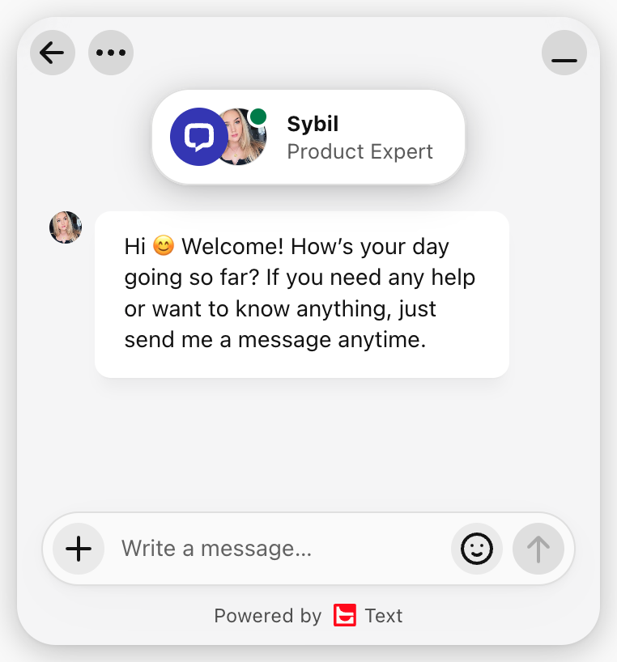
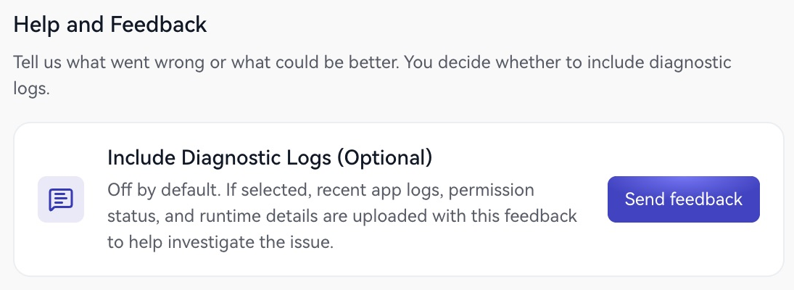
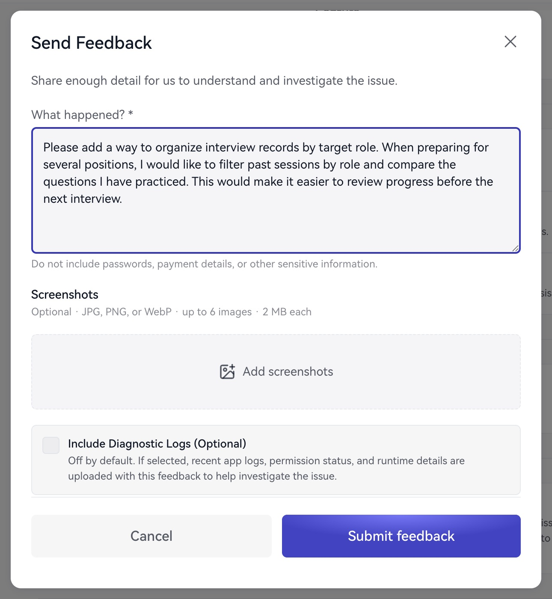

使用过程中需要帮助、咨询订单或提出产品建议时，可以选择在线客服、反馈表单或邮件。

## 在线客服

**网页端**：点击页面右下角的聊天图标。

<Frame caption="网页端：箭头指向右下角的在线客服入口。">
  
</Frame>

**桌面端**：点击工作台左侧的 **联系客服**。

<Frame caption="桌面端：箭头指向左侧的“联系客服”。">
  
</Frame>

两端使用相同的在线客服窗口。在消息输入框中描述需要协助的事项。

<Frame caption="网页端和桌面端共用的在线客服窗口。">
  
</Frame>

## 应用内反馈

<Frame caption="依次点击 1 应用设置、2 发送反馈。">
  
</Frame>

1. 打开 **应用设置 → 帮助与反馈 → 发送反馈**，也可以从账户菜单选择 **意见反馈**。
2. 在 **发生了什么？** 中说明需求、操作步骤与发生时间。
3. 按需添加 JPG、PNG 或 WebP 截图，最多 6 张，每张不超过 2MB。
4. 如需要，选择 **附加诊断日志（可选）**。
5. 检查内容，点击 **提交反馈**。

<Frame caption="描述建议或问题，按需添加截图和诊断日志。">
  
</Frame>

诊断日志默认关闭；开启后，会随反馈附上近期应用日志、权限状态和运行环境信息，其中可能包含会话文字。提交前请确认愿意提供这些信息，详见[隐私与数据](/zh/privacy/data)。

## 提供哪些信息

- 操作的页面或功能，以及希望完成的任务。
- 发生时间、客户端版本、电脑系统和音频设备。
- 相关会话或订单的时间与名称。
- 已尝试的操作，以及能够说明情况的截图。

提交前遮盖截图中的私人信息，请勿填写密码、验证码或完整支付卡信息。

## 邮件联系

一般支持、套餐与订单咨询：[support@greatoffer.ai](mailto:support@greatoffer.ai)。

隐私与数据权利咨询：[privacy@greatoffer.ai](mailto:privacy@greatoffer.ai)。

也可以先查看[常见问题](/zh/faq)，快速找到相关指南。
